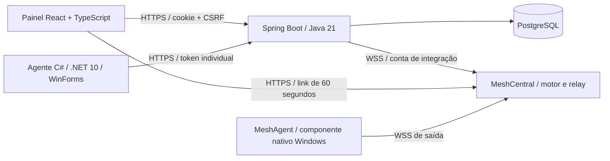

# Análise da referência e decisão de arquitetura

Inspeção em 26/10/2026. Workspace inicialmente vazio, sem repositório Git nem arquivos existentes. Nenhuma alteração preexistente foi sobrescrita.

## Referência examinada

[cleber-2021/PainelRemoto](https://github.com/cleber-2021/PainelRemoto), commit **22ae553221ec154ed5e3500b35b3f5e26d71ed0c**. Foram lidos README, LICENSE, package.json, árvore, autenticação, esquema SQL, servidor, integração Mesh e script de instalação. A verificação é estática: não foi executado um atendimento Windows do projeto original. O README declara operação em centenas de estações; essa escala não foi verificada.

| Tema | Evidência no código | Consequência |
|---|---|---|
| Stack | `package.json`: Express 4, ws 8, qrcode-generator; Node >=22.5. `src/db.js`: node:sqlite | O backend e banco originais não atendem à stack pedida; implementação própria em Spring/PostgreSQL |
| Login | `src/auth.js`: scrypt, salt aleatório, cookies HttpOnly/SameSite Strict e consulta de usuário ativo | Há autenticação real; não é apenas mockup |
| Perfis | `src/db.js`: admin/tecnico e usuario_grupos | Não há perfil solicitante nem modelo de chamados neste esquema |
| Dispositivos | `src/mesh.js`: canal WSS `control.ashx`, sincronização e metadados no SQLite | O painel depende do MeshCentral; não captura tela |
| Remoto | `src/mesh.js:42–59`: cookie no formato MeshCentral e URL `gotonode`; `src/server.js:204–217`: autorização por grupo e emissão de link | Tela/entrada são responsabilidade do MeshCentral/MeshAgent. Código implementa o lançamento; funcionalidade Windows não foi executada aqui |
| Permissões | `src/mesh.js`: conta `painel-<login>` e reconciliação dos direitos por grupo | Conceito reutilizável, mas perfil técnico original permite tela, terminal e arquivos |
| Histórico | `src/server.js:214`: INSERT em acessos quando URL é emitida | Registra tentativa/lançamento, não prova início, recusa, duração ou encerramento da tela |
| Consentimento | Configuração: flags 1, `autoAcceptIfNoUser: true`; cadastro pedir_permissao padrão 0 | Não atende ao consentimento obrigatório e acesso não assistido desativado |
| TLS | `src/mesh.js:21`: caFile configura `checkServerIdentity: () => undefined` | Nesse ramo não há validação do hostname. No novo adaptador, a CA e o hostname são ambos validados |
| Limitação de login | `src/auth.js`: mapa em memória, 10 falhas/IP/15 min | Estado some no reinício; não distribui entre instâncias. O novo backend persiste a contagem e inclui conta |
| Segredos | Sessões do painel original armazenadas em texto no SQLite; chave de cookie do Mesh compartilhada com painel | Comprometimento desse banco/chave amplia impacto. Novo painel armazena hashes de tokens e não compartilha chave criptográfica Mesh |
| Implantação | PowerShell executado como SYSTEM, instala o MeshAgent e pode reinstalar agente de outro servidor | Não foi copiado; a instalação do novo agente é explícita, por usuário e sem serviço |

Não foi feita auditoria exaustiva nem exploração de vulnerabilidades da referência. As observações acima não são prova de exploração remota. README orienta instalação com `npm install`/`npm start`, configuração HTTPS, MeshCentral externo e script customizado; sem esse script, declara sessão inicialmente preta/desconectada. O customizador e o instalador em massa não foram reutilizados no Uai Suporte, pois incluem comportamentos fora do escopo.

## Licenças e reutilização

- [PainelRemoto LICENSE no commit examinado](https://github.com/cleber-2021/PainelRemoto/blob/22ae553221ec154ed5e3500b35b3f5e26d71ed0c/LICENSE): MIT, copyright 2026 Cleber Rocha. Permite uso interno, modificação e distribuição, preservando aviso de copyright e licença em cópias/porções substanciais; sem garantia. Nenhum fonte do PainelRemoto foi copiado para a aplicação. Foram aproveitados conceitos de integração e UX.
- [MeshCentral LICENSE](https://github.com/Ylianst/MeshCentral/blob/master/LICENSE): Apache-2.0. [MeshAgent README, License](https://github.com/Ylianst/MeshAgent#license) também declara Apache-2.0. Uso separado como dependência é compatível com a arquitetura. Redistribuir exige licença, avisos aplicáveis e NOTICE quando presente; alterações em fontes distribuídos devem ser identificadas. Dependências/bibliotecas e binários do agente devem manter seus próprios avisos. Não há exigência geral de abrir o código da aplicação apenas por integrá-los. A licença não concede marcas.
- Fontes da referência são OFL; não foram copiadas. O novo painel usa fontes do sistema.
- Não foi escolhido um licenciamento público para o código original da Uai Telecom. Não publicar automaticamente. A composição de licenças da distribuição final ainda deve ser inventariada, incluindo o binário MeshAgent efetivamente homologado.

## Arquitetura escolhida

**Painel:** usuários, dispositivos, chamados, histórico de solicitações e lançamento de acesso autorizado. Não inventa imagens de tela nem presença de agentes.

**Backend:** identidade do usuário, RBAC, autorização por computador, emissão e revogação de vínculo, presença, consentimento preliminar, sessão curta, chamados e auditoria. Uma instância inicialmente; operações sensíveis de sessão serializadas no processo. Escala horizontal exige locks/filas transacionais e rate limit compartilhado atômico.

**Agente C#:** aplicativo visível na sessão do usuário, heartbeat a cada 5 s, vínculo de uso único, DPAPI CurrentUser, aprovação/recusa inicial e pedido de encerramento. Não é serviço e não captura tela. Fechar ou bloquear a sessão Windows interrompe a disponibilidade após no máximo 30 s sem heartbeat.

**MeshAgent:** exceção explícita à preferência de C# como único agente. O motor escolhido já exige seu agente nativo para capturar tela e aplicar entrada. Reimplementá-lo em C# significaria assumir codecs, protocolo e diversas particularidades Windows. C# permanece o componente próprio da Uai; MeshAgent é uma dependência separada, identificável e desinstalável.

**Transporte e relay:** MeshCentral/WSS já existente; não há criptografia nem protocolo de desktop próprio. WebRTC desativado na prova para manter o fluxo no relay e avaliar expiração/remoção de compartilhamento. O servidor vê o tráfego descriptografado; não se anuncia E2EE. Sem TURN ou outro broker neste desenho. Para acesso externo, usar primeiro VPN. Publicação na internet exigiria DNS/certificados confiáveis, revisão de superfície, MFA, limites e homologação; não basta abrir portas. Agentes fazem conexão de saída, sem porta de controle Windows exposta.

**Persistência:** PostgreSQL para todos os dados Uai. O MeshCentral usa seu armazenamento interno de laboratório em volume próprio; não se trata de um segundo banco da aplicação. Pode ser migrado para PostgreSQL com credenciais/schema separados após validar suporte da versão; essa integração não foi testada. Isso mantém três processos de aplicação (web/API/motor), um banco e nenhum serviço de mensageria.

## Motor e versões

Primeiro foi examinado MeshCentral 1.2.5, a versão citada pela referência. `npm audit` encontrou dependências com alertas altos nessa resolução. A configuração entregue fixa **1.3.1**, com lockfile; foram novamente conferidos os comandos `createDeviceShareLink`, `removeDeviceShare`, autenticação `x-meshauth`, viewOnly, consentimento e expiração no relay. Além da compatibilidade estática, o canal de controle WSS foi exercitado contra o servidor 1.3.1; não é homologação Windows. Um patch mínimo no bootstrap alinha versões de dependências; ver infra/mesh/NOTICE.md. Consulte o relatório de testes para a auditoria da resolução final.

Spring Boot foi fixado em **3.5.16**, Java **21**, React **19**, TypeScript **5.9**, Vite **7**, .NET **10**. O desvio da stack pedida limita-se ao motor Node e MeshAgent como dependências externas necessárias à integração escolhida.

## Fronteira da prova

1. Backend autentica técnico e confirma permissão, presença e vínculo ao chamado.
2. C# apresenta consentimento, padrão Não, com nome do técnico e modalidade.
3. Após aceite, backend pede compartilhamento ao motor com `p=2` (desktop apenas), `viewOnly`, `consent=72` (prompt + barra) e `expire=1` minuto.
4. A URL só é entregue ao mesmo login que iniciou a solicitação, uma única emissão. A URL Mesh é uma credencial bearer: não a compartilhar. O patch Uai agora a vincula a uma única conexão do viewer. Ela abre uma nova janela do MeshCentral, com segundo consentimento local.
5. Revogação, logout, perda de permissão, offline ou expiração provocam `removeDeviceShare`. O relay contém handler que fecha ambos os lados quando recebe removedDeviceShare. Falha no motor fica como STOPPING; não é apresentada como parada confirmada.
6. Em falha de backend, o lease de 12 s no relay e a expiração absoluta do próprio MeshCentral limitam o compartilhamento. O teste Windows deve comprovar que ela corta tanto imagem quanto entrada.

O painel recebe agora consentimento, primeiro bloco de imagem e encerramento do motor. READY significa **link emitido**; ACTIVE exige imagem observada no relay, não comprova renderização no browser. A migração V2 armazena início e confirmação do motor; término confirmado utiliza o instante informado pelo motor. A prova dessa correlação em Windows permanece pendente. A janela remota é a interface do motor, não um viewer React incorporado. Nenhuma sessão real foi anunciada como concluída.

## Atualização de 27/10/2026

A integração agora inclui um patch versionado no relay/core Mesh 1.3.1: telemetria de consentimento/imagem/fim, link de conexão única e lease de 12 s renovado pelo Spring. Não é funcionalidade do projeto de referência nem do MeshCentral sem modificação. Consulte [o contrato, manutenção e análise de assinatura/dependências](06-integracao-e-seguranca-remota.md). Não há atendimento Windows homologado.
