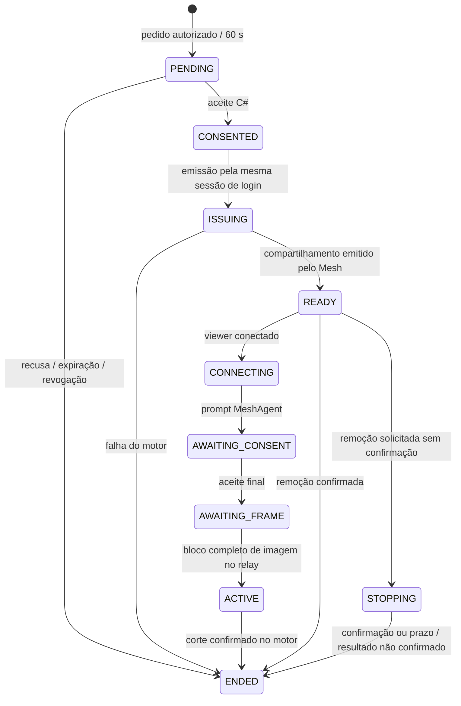

# API do piloto

Base `/api`, JSON, HTTPS. Erros `{ "message": "..." }`, status 400/401/403/404/409/429/502/503. Identificadores UUID. Campos de resposta persistidos usam snake_case; corpos Java usam camelCase conforme abaixo.

## Autenticação

- `POST /auth/login`: `{login,password}` → `{id,name,role,csrf}` e cookie HttpOnly. 10 falhas/15 min por IP/conta.
- `GET /auth/me`: identidade atual e token CSRF.
- `POST /auth/logout`: revoga cookie e solicita encerramento das solicitações do login.
- Toda mutação autenticada por cookie exige `X-CSRF-Token`. Agentes usam Authorization Bearer, nunca o cookie do usuário.

## Administração e dispositivos

- `GET /users`: equipe técnica/admin. Retorna id/name/login/role/active, sem hash.
- `POST /users`: admin; `{name,login,password,role}`. Roles ADMIN, TECNICO, SOLICITANTE.
- `PUT /users/{id}`: admin; `{role,active}`. Revoga sessões existentes da conta. Não permite alterar próprio perfil aqui.
- `GET /devices?q=&location=`: somente autorizados ou de responsabilidade do solicitante. `online` calculado a cada leitura.
- `POST /devices`: admin; `{name,location,department,ownerId?,meshNode?}` → `{id,code,expiresIn}`. Código é exibido uma única vez.
- `PUT /devices/{id}`: admin; mesmos metadados. Não altera cadastro durante solicitação remota aberta.
- `POST /devices/{id}/enrollment`: admin; substitui código de dispositivo ainda sem agente. Não reativa revogado.
- `POST /devices/{id}/revoke`: admin; apaga credenciais, revoga dispositivo e solicita encerramento remoto.
- `GET /devices/{id}/permissions`: admin.
- `PUT /devices/{id}/permissions`: admin; `{userId,control}` concede visualização e, opcionalmente, controle a técnico ativo.
- `DELETE /devices/{id}/permissions/{userId}`: admin; remove permissão e reavalia sessão.
- `GET /devices/{id}/history`: equipe autorizada; chamados e solicitações remotas do computador.

## Agente

- `POST /agent/enroll`: `{code,os}` → `{deviceId,token}`; código válido, não consumido, com prazo de 10 min. Retorna token somente aqui.
- `POST /agent/heartbeat`: Authorization `Bearer <token>`; `{os}` → `{requests,serverTime}`. Cliente consulta a cada 5 s; servidor considera offline após 30 s.
- `POST /agent/sessions/{id}/accept`, `/reject`, `/stop`: só o agente do dispositivo daquela solicitação.

A identidade C# não dá acesso à API de usuários ou a qualquer endpoint de execução de comandos. O Node ID do MeshCentral não é aceito do agente; associação é administrativa.

## Chamados

- `GET /tickets?status=&priority=&technician=&location=`: equipe vê fila; solicitante vê apenas os próprios. Limite de 500 mais recentes.
- `POST /tickets`: `{title,description,category,priority,deviceId?}`. O solicitante é sempre quem autenticou.
- `GET /tickets/{id}`: detalhe, eventos e solicitações remotas; valida dono/perfil.
- `PUT /tickets/{id}`: equipe; `{status,priority,technicianId?}`. Gera evento com antes/depois.
- `POST /tickets/{id}/comments`: `{body}`; dono ou equipe, gera evento imutável pela API.
- Estados ABERTO, EM_ATENDIMENTO, AGUARDANDO, RESOLVIDO; prioridades BAIXA, NORMAL, ALTA, URGENTE.

## Solicitações remotas

- `POST /sessions`: `{deviceId,mode,ticketId?}`; mode VIEW/CONTROL. Ticket, se informado, deve estar associado ao mesmo computador. Requer agente online, autorização e motor habilitado.
- `GET /sessions/{id}`: técnico que solicitou ou administrador; sem tokens/share ID.
- `POST /sessions/{id}/launch`: só o login original, após aceite; retorna `{url}` efêmera. Pode ser emitida apenas uma vez. Não armazene essa URL em logs.
- `POST /sessions/{id}/stop`: solicitante técnico/admin; pode retornar status STOPPING se o motor não confirmar remoção.

READY não é ACTIVE. ACTIVE exige imagem observada no relay. AWAITING_FRAME é o consentimento final; CONSENTED é o aceite preliminar C#. started_at/engine_consent_at/engine_seen_at vêm da integração. ended_at usa o término informado pelo motor quando disponível. Sem confirmação não se afirma corte físico: STOPPING/EXPIRED_UNCONFIRMED. UNVERIFIED é um estado de apresentação quando a confirmação fica antiga ou o painel perde contato. Polling de 3 s, lease de 12 s, prazo absoluto de 60 s. Ver [detalhes e limites](06-integracao-e-seguranca-remota.md).
